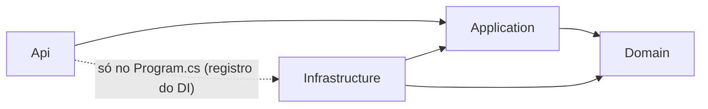

# SADA Task Manager - Desafio Técnico Grupo SADA

API REST para gestão de tarefas: criar, listar, editar e excluir tarefas.

---

## Sumário

- [Tecnologias](#tecnologias)
- [Como rodar](#como-rodar)
- [Endpoints](#endpoints)
- [Como testar](#como-testar)
- [Arquitetura](#arquitetura)
- [Estrutura de pastas](#estrutura-de-pastas)
- [Decisões técnicas (ADRs)](#decisões-técnicas-adrs)

---

## Tecnologias

| Tecnologia                                | Uso                                     |
| ----------------------------------------- | --------------------------------------- |
| .NET 10 / ASP.NET Core 10                 | API REST                                |
| Entity Framework Core (provider InMemory) | Persistência sem banco de dados externo |
| OpenAPI + Swagger UI                      | Documentação da API                     |
| xUnit                                     | Testes                                  |
| Docker                                    | Execução padronizada                    |

---

## Como rodar

### Pré-requisitos

- .NET SDK 10 (qualquer versão 10.0.x; ver `global.json`), ou
- Docker

### Com o .NET SDK

```bash
dotnet run --project src/SadaTaskManager.Api
```

A API sobe na porta 5020. Swagger: http://localhost:5020/swagger

### Com Docker

```bash
docker build -t sada-task-manager .
docker run --rm -p 8080:8080 -e ASPNETCORE_ENVIRONMENT=Development sada-task-manager
```

Swagger: http://localhost:8080/swagger

Se a porta 8080 já estiver em uso, troque só o número da esquerda: `-p 8081:8080` e acesse http://localhost:8081/swagger

> A imagem roda em ambiente **Production** por padrão. Para ver o Swagger, o `docker run`
> deve receber `-e ASPNETCORE_ENVIRONMENT=Development`. O motivo está no [ADR-005](#adr-005--swagger-só-em-development-ligado-por-variável-de-ambiente-no-docker).

---

## Endpoints

| Método | Rota              | O que faz                               | Respostas     |
| ------ | ----------------- | --------------------------------------- | ------------- |
| POST   | `/api/tasks`      | Cria uma tarefa e devolve o Id          | 201, 400      |
| GET    | `/api/tasks`      | Lista as tarefas, com filtros opcionais | 200, 400      |
| GET    | `/api/tasks/{id}` | Busca uma tarefa pelo Id                | 200, 404      |
| PUT    | `/api/tasks/{id}` | Edita todos os campos da tarefa         | 204, 400, 404 |
| DELETE | `/api/tasks/{id}` | Exclui a tarefa                         | 204, 404      |

Qualquer erro inesperado responde 500, com uma mensagem genérica.

Filtros da listagem (todos opcionais, dá para combinar):

- `status`: `Pendente`, `EmProgresso` ou `Concluida`
- `dueDateFrom` e `dueDateTo`: intervalo de vencimento (AAAA-MM-DD), com as duas datas incluídas
- `search`: texto no título, sem diferenciar maiúsculas de minúsculas

Exemplo: `GET /api/tasks?status=Pendente&search=estudar`

A lista vem ordenada pelo vencimento mais próximo, com as tarefas sem vencimento no fim. Quando há
filtro de data, as tarefas sem vencimento ficam de fora e o campo `tasksWithoutDueDate` diz quantas são.

---

## Como testar

```bash
dotnet test
```

### Testes unitários (`tests/SadaTaskManager.UnitTests`)

Cobrem as regras da entidade `TaskItem`: campos obrigatórios, limites de tamanho, status válido,
vencimento no passado e o comportamento do `Update`.

Parte deles são **testes de regressão**: nasceram de bugs encontrados na revisão de código e
existem para garantir que esses bugs não voltem. Exemplos: `Update` funcionando como PATCH em vez
de PUT, atualização que deixava a tarefa pela metade quando falhava, status informado que não era salvo
e PUT sem status que voltava a tarefa para Pendente.

Também cobrem a Application: o `TaskItemService` (feito com TDD), o filtro da listagem (data inicial
maior que a final) e o mapper. O service é testado com um repositório fake sem banco.

### Testes de integração (`tests/SadaTaskManager.IntegrationTests`)

- Repositório: testa o `TaskItemRepository` com o EF Core InMemory. Salvar, editar, excluir,
  filtros por status, datas e busca no título, ordenação e o contador de tarefas sem vencimento.
- Endpoints: sobem a API inteira dentro do teste com `WebApplicationFactory` e fazem requisições HTTP de
  verdade. Conferem os status de resposta (200, 201, 204, 400, 404), as mensagens de erro em português
  e o Swagger mostrando o status como texto.

Total: 56 testes (30 unitários e 26 de integração).

### Testar na mão

Com a API rodando, use o Swagger ou o arquivo `src/SadaTaskManager.Api/SadaTaskManager.Api.http`.
Ele tem uma requisição pronta para cada endpoint, incluindo os casos de erro, e roda direto no
Visual Studio ou no VS Code (extensão REST Client).

---

## Arquitetura

O projeto segue uma adaptação da **Clean Architecture**: o código é dividido em camadas e
**as dependências sempre apontam para dentro**, em direção às regras de negócio.
O Domain (o centro) não conhece banco de dados, HTTP nem nenhuma biblioteca externa.



| Camada             | Responsabilidade                                                                                | Depende de                    |
| ------------------ | ----------------------------------------------------------------------------------------------- | ----------------------------- |
| **Domain**         | Entidade `TaskItem`, enum `TaskItemStatus` e as regras que a tarefa precisa sempre respeitar    | nada                          |
| **Application**    | Casos de uso (service), DTOs, validação de entrada e a interface `ITaskItemRepository`          | Domain                        |
| **Infrastructure** | EF Core: `DbContext`, mapeamento das entidades e implementação do repositório                   | Application, Domain           |
| **Api**            | Controllers, tratamento global de erros, logging, Swagger e a montagem do DI (composition root) | Application, Infrastructure\* |

\* A Api referencia a Infrastructure **apenas** para registrar as implementações no contêiner de
injeção de dependência, dentro do `Program.cs`. Nenhum controller usa tipos da Infrastructure.
Ver [ADR-003](#adr-003--a-api-é-o-composition-root).

Referências:
[The Clean Architecture — Robert C. Martin](https://blog.cleancoder.com/uncle-bob/2012/08/13/the-clean-architecture.html) ·
[Arquiteturas comuns de aplicações web — Microsoft](https://learn.microsoft.com/dotnet/architecture/modern-web-apps-azure/common-web-application-architectures)

---

## Estrutura de pastas

```
SADA-Task-Manager/
├── src/
│   ├── SadaTaskManager.Domain/           # regras de negócio (sem dependências)
│   ├── SadaTaskManager.Application/      # casos de uso, DTOs, interfaces
│   ├── SadaTaskManager.Infrastructure/   # EF Core InMemory, repositório
│   └── SadaTaskManager.Api/              # controllers, erros, logging, Swagger
├── tests/
│   ├── SadaTaskManager.UnitTests/        # testes de Domain e Application
│   └── SadaTaskManager.IntegrationTests/ # testes dos endpoints HTTP
├── global.json                           # versão mínima do SDK (.NET 10)
└── SadaTaskManager.slnx                  # solution (formato .slnx do SDK 10)
```

---

## Decisões técnicas (ADRs)

### ADR-001 — Clean Architecture "leve"

Separei o código em 4 projetos (Domain, Application, Infrastructure e Api) para cada camada ter uma
responsabilidade só e as dependências apontarem para dentro. Assim o próprio compilador impede uma
camada de usar o que não deve, e as regras de negócio podem ser testadas sem banco e sem HTTP.

### ADR-002 — .NET 10

Usei o .NET 10 porque é a versão LTS mais recente e o desafio aceita .NET 8 ou maior. O `global.json`
aceita qualquer SDK 10.0.x. Quem não tiver o SDK instalado pode rodar pelo Docker.

### ADR-003 — A Api é o composition root

A Application define a interface do repositório e a Infrastructure implementa. A Api só referencia a
Infrastructure para registrar essa implementação no `Program.cs`. Os controllers conhecem apenas a
Application, então trocar o banco mexe só na Infrastructure e no `Program.cs`.

### ADR-004 — O Domain não depende do EF Core

O Domain não usa nenhum pacote. O mapeamento do banco fica na Infrastructure, com Fluent API, e os
tamanhos máximos dos campos ficam em constantes do Domain, usadas pela entidade e pelo mapeamento.

### ADR-005 — Swagger só em Development, ligado por variável de ambiente no Docker

A Microsoft recomenda não expor o Swagger em produção, então ele só liga em Development. O `dotnet run`
já sobe em Development. A imagem Docker roda em Production, por isso o `docker run` recebe
`-e ASPNETCORE_ENVIRONMENT=Development`.

### ADR-006 — As regras de negócio ficam na entidade, com `DomainException`

O `TaskItem` valida tudo no construtor e no `Update`: título obrigatório com até 100 caracteres,
descrição com até 1000, status válido e vencimento. Se uma regra é quebrada, ele lança
`DomainException`, que a API devolve como 400. Tudo é validado antes de alterar qualquer campo, então
uma edição recusada não deixa a tarefa pela metade.

### ADR-007 — Vencimento como `DateOnly` e sem datas no passado

O vencimento é só uma data, sem hora, então usei `DateOnly?`. Ao criar, não aceito data no passado.
Ao editar, só confiro a data se ela mudou, para ainda dar para concluir uma tarefa que já venceu.
O "hoje" é calculado em UTC.

### ADR-008 — Id do tipo `Guid` v7, gerado pela entidade

O Id é um `Guid` v7 gerado no construtor do `TaskItem`. A tarefa já nasce com Id, os Ids não são
sequenciais (não dá para adivinhar o próximo) e a versão 7 vem ordenada pela data de criação.
